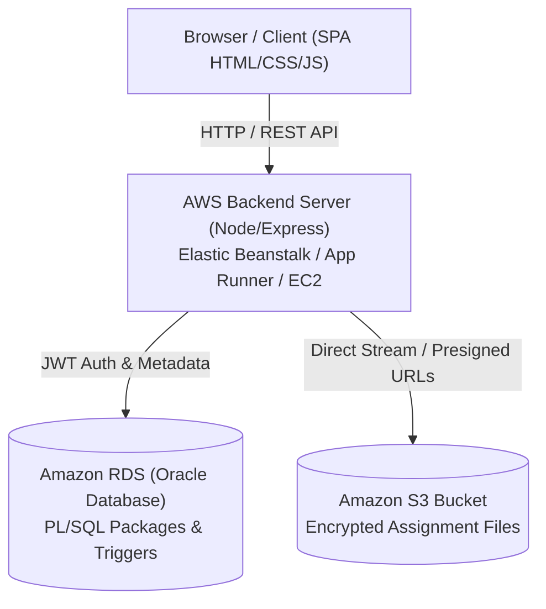

# CloudClass — AWS Academic Assignment Portal

A production-ready academic workspace and cloud assignment management portal engineered for deployment on **Amazon Web Services (AWS)**. Features student and faculty dashboards, secure JWT authentication, automated deadline tracking, direct file storage via **Amazon S3**, and a complete enterprise **Oracle PL/SQL Relational Database** ready for **Amazon RDS**.

---

## 🏛️ System Architecture on AWS



| Component | AWS Service | Purpose |
| :--- | :--- | :--- |
| **Compute & API** | **AWS Elastic Beanstalk / App Runner / EC2** | Runs the Node.js / Express REST API and serves the frontend dashboard. |
| **File Storage** | **Amazon Simple Storage Service (S3)** | High-durability object storage for student homework, PDFs, code ZIPs, and documents. |
| **Database** | **Amazon RDS (Oracle Database)** | Relational schema, automated PL/SQL packages, audit trails, triggers, and gradebooks. |
| **Access Control** | **AWS IAM & JWT Tokens** | Cryptographically signed authentication tokens with role verification (Student vs. Faculty). |

---

## 🚀 Quick Start (Local & Development)

### 1. Install Dependencies
```bash
npm install
```

### 2. Configure Environment (Optional)
Copy `.env.example` to `.env`:
```bash
cp .env.example .env
```
*(If AWS S3 credentials are not yet populated, CloudClass automatically operates with local storage fallback in `./uploads`, allowing instant local testing).*

### 3. Start the Server
```bash
npm start
```
Open **`http://localhost:8000`** in your browser.

---

## 🔑 Demo & Test Credentials

| Role | Identifier / College ID | Password | Portal View |
| :--- | :--- | :--- | :--- |
| **Student** | `102938` (or `john.doe@cloudclass.edu`) | `student123` | Student Dashboard & Submission Upload |
| **Faculty** | `FAC-101` (or `alan.turing@cloudclass.edu`) | `faculty123` | Faculty Dashboard, Create & Grade |
| **Admin** | `admin` (or `admin@cloudclass.edu`) | `Admin@123` | Institutional Administration |

---

## 📁 Project Directory Structure

```
cloudclass_realtime/
├── index.html                  # Responsive student & faculty dashboard UI
├── styles.css                  # Modern UI styles, dark accents, status pills
├── app.js                      # Frontend application logic & live REST polling
├── login.html                  # Dual-portal login interface (Student 6-digit ID & Faculty ID)
├── login.css                   # Login styling and responsive card layout
├── login.js                    # Portal authentication controller
├── api-service.js              # AWS Cloud REST client (replaces Firebase SDK)
├── server.js                   # Node.js Express backend with AWS S3 integration
├── package.json                # Project dependencies (@aws-sdk/client-s3, express, multer, etc.)
├── Dockerfile                  # Container definition for AWS App Runner & ECS
├── docker-compose.yml          # Container orchestration for local / EC2 deployment
├── aws-deployment.md           # Step-by-step deployment guide for Elastic Beanstalk, EC2, App Runner
├── .env.example                # Template for AWS S3 and server environment variables
├── database/                   # Enterprise Oracle PL/SQL Database System (Amazon RDS)
│   ├── init_all.sql            # Master installer script
│   ├── schema.sql              # Tables (users, assignments, submissions), constraints, indexes
│   ├── triggers.sql            # Auto-late detection, max marks check, and audit triggers
│   ├── pkg_auth.sql            # Salted SHA-256 auth, brute-force lockout, session logging
│   ├── pkg_assignment.sql      # Assignment creation, course enrollment, faculty queries
│   ├── pkg_submission.sql      # Submission validation, resubmissions, grading & feedback
│   ├── views.sql               # Analytical views (Faculty dashboard, Gradebook, Audit)
│   ├── seed_data.sql           # Demo accounts, courses, assignments, and submissions
│   ├── test_execution.sql      # Test harness validating login, lockout, and grading logic
│   └── README.md               # Complete PL/SQL architecture and execution manual
└── README.md                   # Project overview & architectural guide
```

---

## ☁️ Deploying to AWS

See [`aws-deployment.md`](file:///d:/cloudclass_realtime/aws-deployment.md) for full instructions:

1. **AWS Elastic Beanstalk**: Easiest single-command deployment with automatic load balancing.
2. **AWS App Runner**: Modern serverless container hosting directly from GitHub or Docker.
3. **AWS EC2**: Virtual server deployment with NGINX reverse proxy and PM2 process manager.
4. **Amazon S3**: Secure bucket setup for assignments with presigned download links.
5. **Amazon RDS**: Host the [PL/SQL schema](file:///d:/cloudclass_realtime/database/schema.sql) in the cloud.

---

## 🛡️ Enterprise Security Features

- [x] **Zero Client Credential Leakage**: No database or cloud storage keys are exposed on the client.
- [x] **Secure S3 Access**: Direct access to bucket files is protected using backend-generated, time-limited presigned URLs.
- [x] **Deadline Enforcement**: Submissions past assignment deadlines are automatically flagged as `'LATE'` by database triggers.
- [x] **Grade Validation**: Prevents awarding marks exceeding assignment maximum points (`ORA-20003`).
- [x] **Audit Trail Preservation**: State transitions and grade changes are logged immutably in `submission_history`.
- [x] **Brute-Force Lockout**: 5 failed login attempts lock the user account in PL/SQL.
