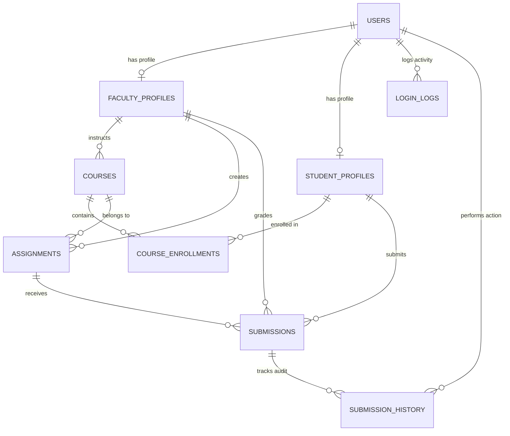

# CloudClass PL/SQL Database Architecture

A comprehensive, production-grade **Oracle PL/SQL Database System** designed to manage user authentication, security auditing, courses, faculty-administered assignments, student submissions, automated deadline enforcement, and gradebooks.

---

## 1. System Architecture & Entity Relationships

---

## 2. Database Components

| File | Purpose | Description |
| :--- | :--- | :--- |
| [`init_all.sql`](file:///d:/cloudclass_realtime/database/init_all.sql) | **Master Installer** | Runs all schema scripts, triggers, packages, views, and seed data in proper sequence. |
| [`schema.sql`](file:///d:/cloudclass_realtime/database/schema.sql) | **Schema & Tables (DDL)** | Defines 9 relational tables, sequences, foreign keys, check constraints, and B-Tree indexes. |
| [`triggers.sql`](file:///d:/cloudclass_realtime/database/triggers.sql) | **Business Logic Triggers** | Automated timestamp updates, automatic `LATE` detection past deadlines, max points validation, and submission history auditing. |
| [`pkg_auth.sql`](file:///d:/cloudclass_realtime/database/pkg_auth.sql) | **Authentication Package** | Salted SHA-256 password hashing, user registration, login verification, brute-force lockout (5 attempts), and login logging. |
| [`pkg_assignment.sql`](file:///d:/cloudclass_realtime/database/pkg_assignment.sql) | **Assignment Package** | Faculty creation, modification, status toggling, course enrollment, and student/faculty query ref cursors. |
| [`pkg_submission.sql`](file:///d:/cloudclass_realtime/database/pkg_submission.sql) | **Submissions Package** | File upload verification (types, max size), resubmission tracking, faculty grading, rejection handling, and student gradebooks. |
| [`views.sql`](file:///d:/cloudclass_realtime/database/views.sql) | **Reporting Views** | Analytics for faculty dashboards, student portals, pending grading queues, and security audit trails. |
| [`seed_data.sql`](file:///d:/cloudclass_realtime/database/seed_data.sql) | **Seed & Demo Records** | Preloads Admin, 2 Faculty members, 3 Students, 3 Courses, Enrollments, Assignments, and Submissions. |
| [`test_execution.sql`](file:///d:/cloudclass_realtime/database/test_execution.sql) | **Verification Harness** | Demonstrates login tests, account lockout simulation, admin unlock, trigger violations, and view queries. |

---

## 3. Relational Table Schema Summary

### `USERS`
* **`user_id`**: Primary Key (Sequence generated).
* **`username`**: Unique handle (`VARCHAR2(50)`).
* **`email`**: Unique login email (`VARCHAR2(120)`).
* **`password_hash`**: Hex-encoded SHA-256 hash with cryptographic salt (`VARCHAR2(128)`).
* **`password_salt`**: Unique 32-character hex salt per user (`VARCHAR2(64)`).
* **`role`**: Check constraint (`'STUDENT'`, `'FACULTY'`, `'ADMIN'`).
* **`status`**: Account status (`'ACTIVE'`, `'LOCKED'`, `'SUSPENDED'`).
* **`failed_attempts`**: Tracks consecutive wrong password attempts.
* **`last_login_at`**: Timestamp of latest successful authentication.

### `LOGIN_LOGS`
* **`log_id`**: Primary Key.
* **`user_id`**: Foreign Key to `USERS`.
* **`attempted_email`**: Email supplied during login attempt.
* **`ip_address`**, **`user_agent`**: Client connection metadata.
* **`login_status`**: `'SUCCESS'`, `'FAILED'`, or `'LOCKED'`.
* **`failure_reason`**: E.g., `'INCORRECT_PASSWORD'`, `'USER_NOT_FOUND'`, `'MAX_ATTEMPTS_EXCEEDED'`.

### `FACULTY_PROFILES`
* **`faculty_id`**: Primary Key.
* **`user_id`**: Foreign Key to `USERS` (1-to-1).
* **`employee_code`**: Unique institutional code (e.g., `'FAC-CS-001'`).
* **`full_name`**, **`department`**, **`designation`**, **`phone_number`**, **`office_room`**.

### `STUDENT_PROFILES`
* **`student_id`**: Primary Key.
* **`user_id`**: Foreign Key to `USERS` (1-to-1).
* **`roll_number`**: Unique student college ID (e.g., `'24CS101'`).
* **`full_name`**, **`department`**, **`semester`**, **`batch_year`**, **`phone_number`**.

### `COURSES` & `COURSE_ENROLLMENTS`
* Connects faculty instructors with courses and enrolls students into courses with unique composite constraint `(course_id, student_id)`.

### `ASSIGNMENTS` (Given by Faculty)
* **`assignment_id`**: Primary Key.
* **`course_id`**, **`faculty_id`**: Foreign Keys.
* **`assignment_code`**: e.g., `'DBMS-ASG-01'`.
* **`title`**, **`instructions`** (`CLOB`).
* **`max_points`**: Positive numeric points ceiling (e.g., `100.00`).
* **`deadline`**: `TIMESTAMP WITH TIME ZONE`.
* **`allowed_file_types`**: e.g., `'.pdf,.zip,.doc'`.
* **`max_file_size_mb`**: Maximum file size in MB.
* **`status`**: `'DRAFT'`, `'PUBLISHED'`, `'CLOSED'`, `'ARCHIVED'`.

### `SUBMISSIONS` (Submitted by Students)
* **`submission_id`**: Primary Key.
* **`assignment_id`**, **`student_id`**: Foreign Keys.
* **`submitted_at`**: Timestamp of student turn-in.
* **`file_name`**, **`storage_path`**, **`file_size_kb`**, **`student_note`**.
* **`status`**: `'SUBMITTED'`, `'LATE'`, `'UNDER_REVIEW'`, `'GRADED'`, `'REJECTED'`, `'RESUBMITTED'`.
* **`marks_obtained`**: Score awarded by faculty (`0 <= marks_obtained <= max_points`).
* **`faculty_feedback`**: Notes, suggestions, and grading rubric remarks (`CLOB`).
* **`graded_by`**: Foreign key to `FACULTY_PROFILES`.
* **`attempt_number`**: Increments on resubmissions.

### `SUBMISSION_HISTORY`
* Immutable audit trail logging state changes, mark alterations, resubmissions, and user responsible.

---

## 4. Business Logic Packages

### 1. `PKG_AUTH`
* `pkg_auth.hash_password(p_password, p_salt)`: Salted SHA-256 standard hash.
* `pkg_auth.register_student(...)`: Creates user account + student profile in a single atomic transaction.
* `pkg_auth.register_faculty(...)`: Creates user account + faculty profile.
* `pkg_auth.login(...)`: 
  * Verifies email & salted hash.
  * Resets `failed_attempts` on success.
  * Increments counter and automatically sets account status to `'LOCKED'` after 5 failed attempts.
  * Logs every attempt to `LOGIN_LOGS`.
* `pkg_auth.unlock_account(p_user_id)`: Unlocks locked accounts.
* `pkg_auth.change_password(...)`: Validates existing password before applying salt and new hash.

### 2. `PKG_ASSIGNMENT`
* `pkg_assignment.create_assignment(...)`: Enforces faculty authorization and future deadline checks.
* `pkg_assignment.update_assignment(...)`: Allows editing assignment details.
* `pkg_assignment.set_assignment_status(...)`: Toggles between `DRAFT`, `PUBLISHED`, `CLOSED`.
* `pkg_assignment.enroll_student(...)`: Enrolls student into course.
* `pkg_assignment.get_faculty_assignments(p_faculty_id)`: Returns cursor of assignments with submission and grading metrics.
* `pkg_assignment.get_student_assignments(p_student_id)`: Returns cursor of assignments for enrolled courses with personal status.

### 3. `PKG_SUBMISSION`
* `pkg_submission.submit_assignment(...)`:
  * Validates course enrollment.
  * Validates file extension against allowed types.
  * Enforces maximum file size limit.
  * Automatically sets status to `'LATE'` if submitted after deadline.
  * Supports seamless resubmission with attempt numbering.
* `pkg_submission.grade_submission(...)`:
  * Verifies faculty authorization over assignment.
  * Validates `0 <= marks_obtained <= max_points`.
  * Sets status to `'GRADED'`, attaches feedback, and triggers history audit.
* `pkg_submission.reject_submission(...)`: Flags submission for student rework with reason.
* `pkg_submission.get_assignment_submissions(p_asg_id, p_fac_id)`: Cursor of submissions for faculty grading queue.
* `pkg_submission.get_student_gradebook(p_student_id)`: Cursor of student grades and feedback.

---

## 5. Automated Triggers

1. **`trg_users_update_ts`**: Automatically sets `updated_at := SYSTIMESTAMP` on user updates.
2. **`trg_assignments_update_ts`**: Automatically sets `updated_at := SYSTIMESTAMP` on assignment updates.
3. **`trg_submissions_integrity`**:
   - Rejects submissions to closed assignments (`ORA-20001`).
   - Compares submission time with assignment deadline; if past deadline, auto-tags status as `'LATE'`.
   - Rejects negative marks (`ORA-20002`).
   - Rejects marks exceeding assignment `max_points` (`ORA-20003`).
4. **`trg_submissions_history_audit`**: Writes audit record to `SUBMISSION_HISTORY` on new submissions, grade assignments, or status updates.

---

## 6. How to Run & Deploy

### Option A: Using Oracle SQL Developer / SQL*Plus / Toad
1. Open SQL Developer and connect to your Oracle database schema (e.g., `XE`, `FREE`, `ORCL`, or Oracle Cloud ATP/ADW).
2. Open [`init_all.sql`](file:///d:/cloudclass_realtime/database/init_all.sql).
3. Execute the script as a script (`F5` in SQL Developer or `@init_all.sql` in SQL*Plus).
4. Run [`test_execution.sql`](file:///d:/cloudclass_realtime/database/test_execution.sql) (`F5`) to verify test scenarios and view output in the `DBMS_OUTPUT` console.

### Option B: Using Oracle Live SQL (Web Browser)
If using [Oracle Live SQL](https://livesql.oracle.com/):
1. Copy the contents of [`schema.sql`](file:///d:/cloudclass_realtime/database/schema.sql) into SQL Worksheet and run.
2. Run [`triggers.sql`](file:///d:/cloudclass_realtime/database/triggers.sql).
3. Run [`pkg_auth.sql`](file:///d:/cloudclass_realtime/database/pkg_auth.sql).
4. Run [`pkg_assignment.sql`](file:///d:/cloudclass_realtime/database/pkg_assignment.sql).
5. Run [`pkg_submission.sql`](file:///d:/cloudclass_realtime/database/pkg_submission.sql).
6. Run [`views.sql`](file:///d:/cloudclass_realtime/database/views.sql).
7. Run [`seed_data.sql`](file:///d:/cloudclass_realtime/database/seed_data.sql).

---

## 7. Pre-Configured Test Credentials (from Seed Data)

| Role | Email | Password | Identifier / Code |
| :--- | :--- | :--- | :--- |
| **Admin** | `admin@cloudclass.edu` | `Admin@123` | System Administrator |
| **Faculty** | `alan.turing@cloudclass.edu` | `Faculty@123` | Dr. Alan Turing (`FAC-CS-001`) |
| **Faculty** | `grace.hopper@cloudclass.edu` | `Faculty@123` | Dr. Grace Hopper (`FAC-IT-002`) |
| **Student** | `john.doe@cloudclass.edu` | `Student@123` | John Doe (`24CS101`) |
| **Student** | `jane.smith@cloudclass.edu` | `Student@123` | Jane Smith (`24CS102`) |
| **Student** | `alex.patel@cloudclass.edu` | `Student@123` | Alex Patel (`24IT201`) |
